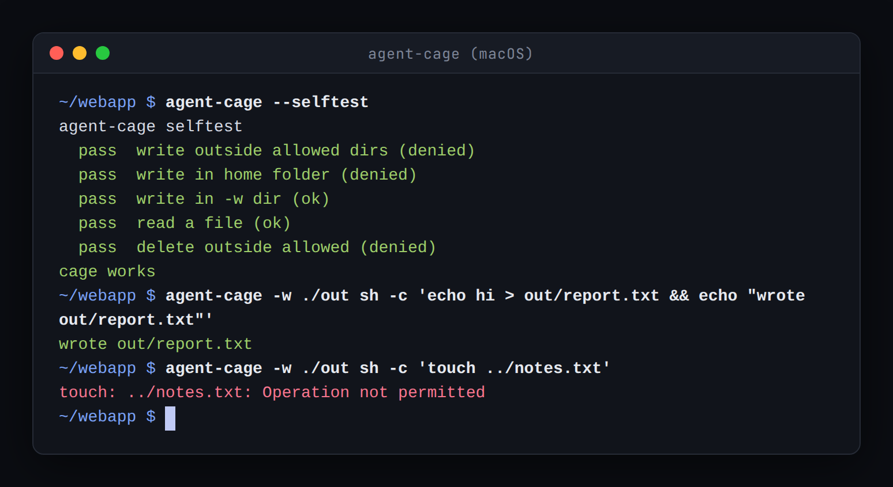

# agent-cage
Runs Claude Code, Codex or any command on macOS so it cannot write anywhere except the folders you allow, enforced by the kernel sandbox, not by the agent's own allowlist.



```
curl -fsSL https://raw.githubusercontent.com/kilazi/agent-cage/main/install.sh | sh
```

## Use
```
agent-cage claude -p "review this repo"            # read-only
agent-cage -w ./out claude -p "write the report"   # writes only in ./out
agent-cage -w . codex exec "fix the failing test"  # writes only in this repo
```
`-n` blocks network, `--print` shows the profile, `--selftest` proves it works on your Mac.
The agent's own state (`~/.claude`, `~/.codex`, caches) and temp dirs stay writable; its settings and hooks do not.

## Why not X?
- Claude Code's built-in `/sandbox` isolates the commands its Bash tool runs. agent-cage puts the whole process under the kernel profile, so the file edit tools, MCP servers and anything they start are caged too.
- Wrappers like paulsmith/claude-sandbox also run the CLI under `sandbox-exec`, set up for Claude Code in the current project. agent-cage takes any command (Claude Code, Codex, a script), is read-only unless you pass `-w`, stops the agent from editing its own settings and hooks, and `--selftest` shows the cage holds on your machine.
- Trade-offs: macOS only, and reads and network stay open (`-n` blocks network).

Apache-2.0. Reusing it? Keep the NOTICE: credit kilazi/agent-cage.

More: https://kilazi.com/wiki/agent-cage/ · by kilazi
